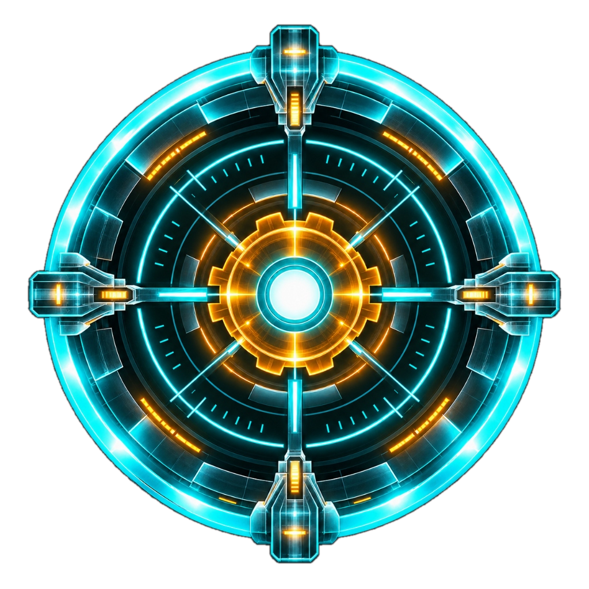
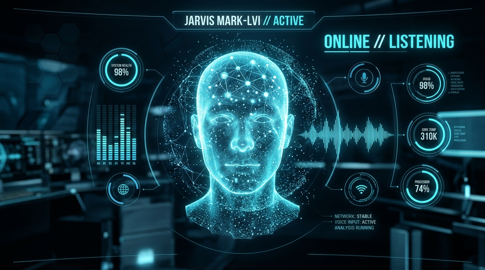
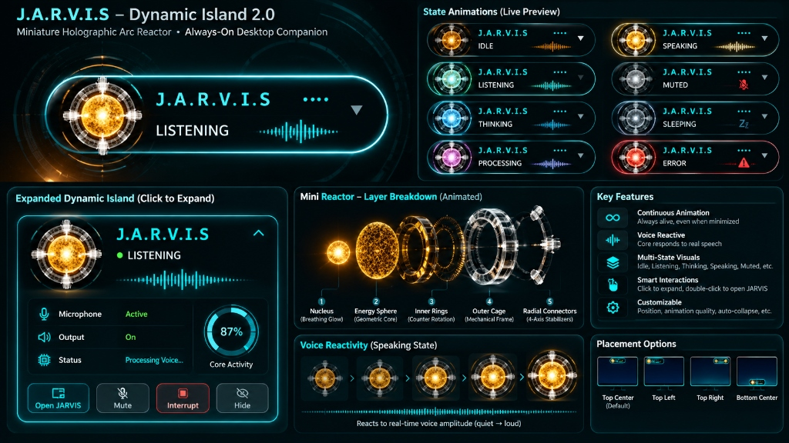
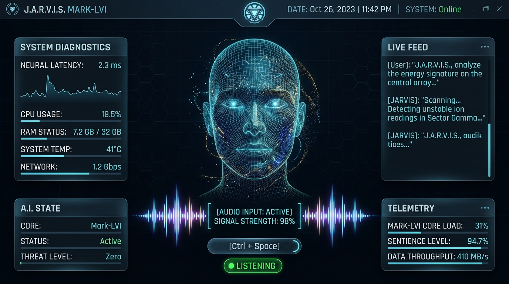
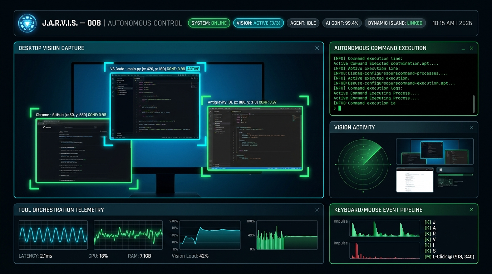

# ⚡ J.A.R.V.I.S. — MARK LVI

<div align="center">



<p align="center">
  <strong>Autonomous Multimodal AI Desktop Assistant • Visual Context Intelligence • Dynamic Island 2.0 • Antigravity Neural Bridge</strong>
</p>

[](https://github.com/ajinkyachalke008/Mark-LVI)
[-4facfe?style=for-the-badge&logo=git&logoColor=white)](https://github.com/ajinkyachalke008/Mark-LVI/releases)
[](https://www.python.org/)
[](LICENSE)

[](https://ai.google.dev/)
[](https://github.com/ajinkyachalke008/Mark-LVI)
[](https://github.com/ajinkyachalke008/Mark-LVI)
[](https://github.com/ajinkyachalke008/Mark-LVI)
[](https://github.com/ajinkyachalke008/Mark-LVI)
[](https://github.com/ajinkyachalke008/Mark-LVI/stargazers)
[](https://github.com/ajinkyachalke008/Mark-LVI/network/members)

<p align="center">
  <a href="#-system-status--live-telemetry"><b>Live Status</b></a> •
  <a href="#-interface--capabilities-showcase"><b>Interface Tour</b></a> •
  <a href="#-key-capabilities"><b>Capabilities</b></a> •
  <a href="#-whats-new-in-mark-lvi"><b>What's New</b></a> •
  <a href="#-quick-start"><b>Quick Start</b></a> •
  <a href="#-project-architecture"><b>Architecture</b></a> •
  <a href="#-security--data-privacy"><b>Security</b></a>
</p>

</div>

---

## 📡 System Status & Live Telemetry

<div align="center">
  
</div>

> [!NOTE]
> Mark LVI introduces native dual-mode execution: an ultra-low latency cloud stream powered by **Gemini 3.1 Flash Live** combined with a zero-cost local fallback engine (**Ollama**, **LM Studio**, **llama.cpp**, **vLLM**), coupled with an always-on **Dynamic Island 2.0** desktop companion and a **Google Antigravity IDE** Agent Chat bridge.

---

## 📸 Interface & Capabilities Showcase

<div align="center">
  
</div>

<br />

### 🏝️ Dynamic Island 2.0 — Miniature Holographic Arc Reactor Companion

<div align="center">
  
</div>

<br />

<div align="center">
  
</div>

<br />

<table align="center" width="100%">
  <tr>
    <td width="50%" align="center">
      <b>🧑‍🎤 3D Holographic Avatar &amp; Live HUD</b><br />
      <br />
      <i>Software-rendered real-time facial rig with dynamic visemes, acoustic frequency visualizer, and push-to-talk integration.</i>
    </td>
    <td width="50%" align="center">
      <b>🖥️ Autonomous Computer Control &amp; Vision</b><br />
      <br />
      <i>Real-time screen OCR, bounding box vision coordinates, verified window focus management, and foreground app control.</i>
    </td>
  </tr>
</table>

---

## 🌟 Key Capabilities

### 🏝️ Dynamic Island 2.0 (Miniature Holographic Companion)

<div align="center">
  
</div>

- **5-Layer Animated Arc Reactor:** Pure `QPainter` vector rendering reproducing an authentic Stark Industries Arc Reactor at miniature scale (30 DIP):
  1. *Nucleus:* Intense white-hot core with breathing glow and voice amplitude flare.
  2. *Energy Sphere:* Geometric amber matrix wireframe with warm ambient illumination.
  3. *Inner Containment Rings:* Dual counter-rotating precision notched rings.
  4. *Outer Mechanical Cage:* High-contrast silver/white segmented structural frame rotating clockwise.
  5. *Radial Connectors:* 4-axis mechanical alignment tabs (0°, 90°, 180°, 270°).
- **Acoustic Voice Reactivity:** Smoothly modulates core flare radius, rotational velocity, and corona intensity in real time according to live vocal amplitude (RMS smoothing).
- **Compact Refined Footprint ($180 \times 42\text{ DIP}$):** Optimized horizontal pill engineered to sit unobtrusively just below the webcam bezel at top-center (15% slimmer footprint, balanced proportions).
- **30 FPS Traveling Photon Perimeter Sweep:** Futuristic cyan edge lighting featuring multi-pass border halo, continuous traveling light sweep, and smooth hover illumination.
- **Always-On Persistence:** Runs as an independent top-level companion window (`Qt.WindowType.WindowStaysOnTopHint | Qt.WindowType.FramelessWindowHint | Qt.WindowType.Tool`). Remains active, listening, and voice-reactive even when the primary JARVIS window is minimized or hidden in the system tray.
- **3-Way Synchronized Visibility Control:** Toggle the companion on or off seamlessly from:
  1. *HUD Controls Drawer:* Dedicated `🏝  DYNAMIC ISLAND: ON/OFF` push button with cyan glow styling.
  2. *Windows System Tray Menu:* Context-menu toggle item synchronized instantly.
  3. *Expanded Island Dashboard:* Click the `Hide` button to collapse back to tray/drawer.
- **Expandable Telemetry Dashboard:** Click the collapsed pill to reveal full telemetry: real-time microphone status, audio output, processing state, 87% core activity gauge, and quick actions (`Open JARVIS`, `Mute`, `Interrupt`, `Hide`).
- **Flexible Display Placement:** Automatically snaps to display edges: Top Center (default), Top Left, Top Right, or Bottom Center with per-monitor DPI scaling.

---

### ⚡ Antigravity IDE Direct Input & Terminal Bridge

<div align="center">
  
</div>

- **Programmatic Agent Chat Input:** Injects user or assistant-generated prompts directly into Google Antigravity IDE's active agent chat window (`actions/antigravity_chat.py` and `core/integrations/antigravity_controller.py`).
- **Target Chat Focus (`Ctrl+L`):** Automatically locates running Antigravity IDE windows, brings them to foreground with Win32 `HWND_TOPMOST` z-order focus, and triggers `Ctrl+L` to focus the chat input bar.
- **Atomic Clipboard Guard:** Backs up existing developer clipboard text before delivery, injects the prompt payload via Unicode clipboard paste, and immediately restores original clipboard contents.
- **Insert vs. Submit Modes:** Supports both interactive insertion (`submit=False` for developer review) and autonomous execution (`submit=True` for instant dispatch).
- **Process Hierarchy Isolation:** `core/appidentity.py` ancestor process tracking ensures `Antigravity IDE.exe` and `explorer.exe` are never misidentified as JARVIS self-processes, guaranteeing reliable foreground elevation.
- **Autonomous Tool Declaration:** Exposes `antigravity_chat` directly into Gemini Live's multimodal tool definitions for hands-free voice execution (*"Hey Jarvis, ask Antigravity to write unit tests for the Dynamic Island"*).
- **Universal REST Bridge:** Integrated local HTTP server (`http://127.0.0.1:24680`) exposing `POST /api/chat` and `POST /api/terminal` for multi-language scripts and external tools.

---

### 🔮 Iron Man 3D Holographic Orb HUD
- **Hardware-Accelerated WebGL Centerpiece:** Authentic Iron Man / Ultron-inspired 3D holographic energy orb embedded directly into the central JARVIS HUD via QtWebEngine and Three.js.
- **7-Layer Holographic Architecture:** Layered geodesic outer shell, 30 segmented rotating meridian arcs, glowing inner core, 160+ floating 3D telemetry glyphs, 220 orbiting debris particles, and dynamic expanding scanning rings.
- **Live State & Audio Reactivity:** Center energy core smoothly breathes and pulses with live user and assistant vocal amplitude, shifting color, rotation velocity, and bloom across `IDLE`, `LISTENING`, `THINKING`, and `SPEAKING` states.
- **Interactive Orbit Controls:** Full 3D camera navigation (left-click drag to rotate, right-click drag to pan, scroll wheel to zoom, press `R` to reset).
- **Three Centerpiece Modes:** Seamless hot-swapping between `🔮 3D HOLOGRAPHIC ORB`, `🧑 ANIMATED FACE`, and 2D vector `◉ REACTOR CORE` with zero reload overhead.

### 🧑‍🎤 Holographic Avatar & Facial Geometry
- **Software 3D Engine:** An animated human head rendered via pure software rasterization (`PyQt6.QtGui.QPainter`). No dedicated GPU or heavy game engine required.
- **Formant & Transcript Lip-Sync:** Produces ~50 expressive mouth shapes per second calculated from acoustic audio formants fused with text visemes.
- **Script-Agnostic Articulation:** Unicode reduction maps Latin, Cyrillic, Greek, and other global scripts cleanly onto anatomical mouth phonemes.
- **Natural Micro-Expressions:** Contextual brow elevation during questions, ocular saccadic drift, spontaneous blinking, and rhythmic syllable nods.

### 🎙️ Fluid Voice & Audio Pipeline
- **Global Push-to-Talk:** Tap or hold `Ctrl+Space` anywhere in your OS to engage the microphone. Audio streams only when requested.
- **Local "Hey Jarvis" Wake Word:** Zero-cloud, on-device acoustic keyword spotting powered by `openwakeword`. Sleeps until invoked and never transmits background audio.
- **Acoustic Self-Echo Cancellation:** Adaptive reference subtractor distinguishes your speech from the assistant's own synthesized voice in real time.
- **Instant Latency Masking:** Synthesizes low-latency immediate audio acknowledgments in the user's spoken language while complex reasoning plans compute.

### 🖥️ Verified Autonomous Computer Control & Perception
- **Observation-Driven Action:** Tools report observed ground-truth rather than simple invocation state (`done` indicates verified UI state, `unverified` signifies an unconfirmed attempt).
- **Multi-Process Foreground Focus:** Inspects complete Windows process hierarchies and raises launched apps to `HWND_TOPMOST` foreground visibility.
- **Multimodal Visual Grounding:** Coordinates real-time multi-monitor screen captures, UI element bounding boxes, and OCR target recognition with 25px centroid element snapping.
- **Human-Like Bézier Movement:** Generates parametric cubic Bézier mouse curves with micro-jitter, hover-settle delays, and Unicode clipboard typing fallbacks.
- **Pre/Post Action Verification:** Calculates visual pixel deltas and focus shifts before reporting results via `core.outcome`.

### 🛡️ Full Desktop Access & Fail-Safe Emergency Stop
- **Explicit Authorized Sessions:** Desktop automation is locked behind an explicit permission gate (`DesktopAccessState.CONTROL_ENABLED`).
- **Granular Security Scopes:** Independent permission gates for `SCREEN_CAPTURE`, `MOUSE_MOVE`, `MOUSE_CLICK`, `KEYBOARD_INPUT`, and `CLIPBOARD_ACCESS`.
- **Inactivity Watchdogs:** Sessions expire automatically after idle timeouts to ensure unattended machines remain secure.
- **Redundant Emergency Stop:** Immediate fail-safe halts triggered via `Ctrl+Alt+Escape`, moving cursor rapidly into any screen corner, or clicking the HUD stop button, instantly releasing all held keys and mouse buttons.

### 🔍 Circle-to-Understand (C2U) Visual Interaction
- **Multi-Monitor Transparent Overlay:** Press `Ctrl+Alt+S` or click `CIRCLE TO EXPLAIN` in the HUD to freeze the desktop across all active monitors.
- **Freeform Lasso & Box Selection:** Circle, loop, or drag a rectangle around any UI element, diagram, code snippet, or error message.
- **Multimodal Context Explanation:** Crops the selected region with high fidelity and dispatches it directly to the Gemini vision pipeline, streaming audible and visual explanations to the HUD.

### 📐 Universal Creation Studio (CAD, Circuits & Workflows)
- **Native PyQt6 Studio Workspace:** Interactive multi-domain canvas (`StudioWindow`) featuring infinite smooth pan, zoom (0.1x to 25x), and snap-to-grid.
- **2D Mechanical CAD:** Engineering plate modeling, corner fillets, bolt hole patterns, cutouts, and dimension annotations.
- **Circuit Schematics:** Electronics schematic generator with component pins, netlist wires, and power regulation circuits.
- **Workflow Architecture:** Process flowcharts, decision nodes, and autonomous agent loop diagrams.
- **Multi-Format Exporters:** Export to standard **AutoCAD R12/2000 ASCII DXF**, scalable **SVG**, 300 DPI **PNG**, and native **JSON**.
- **Demonstrator Project Included:** Precision mechanical mounting plate ($120\text{ mm} \times 80\text{ mm}$, corner fillets, 4 M4 holes, center cutout, dimensions) exported directly to `Desktop/JarvisCreations/`.

---

## 🔄 What's New in Mark LVI

### 1. Dual Engine Architecture (Cloud + Local)
Mark LVI untethers the assistant from proprietary cloud locks:
- **Cloud Mode:** Runs directly on Gemini 3.1 Flash Live for natural sub-second audio conversation.
- **Local Mode:** Switches seamlessly to on-device LLMs through any standard OpenAI-compatible server endpoint:
  - [Ollama](https://ollama.ai) (`http://localhost:11434/v1`)
  - [LM Studio](https://lmstudio.ai) (`http://localhost:1234/v1`)
  - [llama.cpp](https://github.com/ggerganov/llama.cpp) / [vLLM](https://github.com/vllm-project/vllm)
- **Zero Idle Overhead:** If local providers are not configured, the `providers/` module is never loaded (measured import boot time impact: **0.16 ms**).

### 2. Upgraded Model Ladder & Fault-Tolerant Fallbacks
- Replaced outdated API models with high-availability production endpoints (`gemini-flash-lite-latest` and `gemini-3.8-flash`).
- Dynamic rate-limit and quota backoff prevents crashes when quotas are saturated.

### 3. Foreground Window & Multi-Process Visibility
- Refactored `actions/browser_control.py` and `core/appidentity.py` with multi-PID hierarchy tracking.
- Bypassed hidden process monkey-patching so user applications retain visible graphical windows upon launch.

### 4. Background Automation & Dispatch Tools
- Added [`plugins/github_manager.py`](file:///C:/Users/AJINKYA%20CHALKE/AI/Mark-LVI/plugins/github_manager.py) for autonomous repository inspection, issue review, and pull request tracking.
- Added [`plugins/file_dispatcher.py`](file:///C:/Users/AJINKYA%20CHALKE/AI/Mark-LVI/plugins/file_dispatcher.py) and [`plugins/desktop_downloader.py`](file:///C:/Users/AJINKYA%20CHALKE/AI/Mark-LVI/plugins/desktop_downloader.py) for workspace organization and download automation.

### 5. Antigravity IDE Direct Input Channel & Automation Bridge
- Added [`antigravity_ide_api.py`](file:///C:/Users/AJINKYA%20CHALKE/Desktop/my%20AI%20agent/antigravity_ide_api.py) delivering `insert_prompt_to_chat` and `execute_terminal_command`.
- Added [`plugins/antigravity_bridge.py`](file:///C:/Users/AJINKYA%20CHALKE/Desktop/my%20AI%20agent/plugins/antigravity_bridge.py) allowing JARVIS to control Antigravity IDE directly via voice.
- Added [`tools/antigravity_input_gui.py`](file:///C:/Users/AJINKYA%20CHALKE/Desktop/my%20AI%20agent/tools/antigravity_input_gui.py) and desktop shortcut `JARVIS Antigravity Input.lnk` for instant desktop execution.
- Integrated background REST HTTP server (`http://127.0.0.1:24680`) for cross-language automation.

### 6. Universal Desktop Agent & Visual Context Intelligence
- **Full Desktop Access Mode:** Permission-controlled desktop interaction with granular scopes (`SCREEN_CAPTURE`, `MOUSE_MOVE`, `MOUSE_CLICK`, `KEYBOARD_INPUT`), session timeouts, and instant fail-safe **Emergency Stop** (`Ctrl+Alt+Escape`, mouse corner flick, or HUD halt).
- **Circle-to-Understand (C2U):** Transparent multi-monitor overlay window (`Ctrl+Alt+S`) for freeform lasso or rectangular region selection, freezing the screen and explaining any content via the vision pipeline.
- **Advanced Desktop Perception:** Multi-monitor MSS virtual capture, per-monitor DPI awareness v2, native Windows UI Automation (`pywinauto` UIA backend), and normalized visual grounding.
- **Intelligent Bézier Cursor Control:** Human-like cubic Bézier mouse movement with randomized perpendicular deviation, ease-in-out velocity curves, hover-settle clicks, and pre/post action state diff verification (`core.outcome`).

### 7. Universal Creation Studio (CAD, Circuits & Workflows)
- **Multi-Domain Studio Canvas:** Native PyQt6 interactive workspace (`StudioWindow`) featuring infinite smooth pan, zoom, grid snapping, and element inspection.
- **2D Mechanical CAD:** Precise engineering modeling (plates, fillets, mounting holes, cutouts, dimension annotations).
- **Circuit Schematics:** Electronics schematic generator with component pins, netlists, and power regulation circuits.
- **Workflow Architecture:** Process flowcharts, decision nodes, and autonomous agent loop diagrams.
- **Multi-Format Exporters:** Export to standard **AutoCAD R12/2000 ASCII DXF**, scalable **SVG**, high-res **PNG**, and native **JSON**.
- **CAD Demonstrator Included:** Built-in precision mechanical mounting plate ($120\text{ mm} \times 80\text{ mm}$, corner fillets, 4 M4 holes, center cutout, dimensions).

### 8. Iron Man 3D Holographic Orb HUD Integration (Ultron Engine)
- **Embedded WebGL Three.js Viewport:** 3D animated holographic energy sphere embedded inside `HudCanvas` via PyQt6-WebEngine with hardware acceleration (ANGLE Direct3D11).
- **Offline IIFE Self-Contained Bundle:** Single minified local bundle (`assets/orb/orb_bundle.js`) eliminating CORS and network dependencies for instant offline loading.
- **Dynamic 7-Layer Visual Structure:** Outer geodesic sphere, segmented rotating meridian rings, glowing inner core, 160+ floating technical HUD text sprites, 220 orbiting particle debris, and scanning pulse rings.
- **Bidirectional QWebChannel Bridge:** Python-to-JavaScript IPC (`core/hud/orb_bridge.py`) routing live assistant states (`IDLE`, `LISTENING`, `THINKING`, `SPEAKING`, `MUTED`) and live vocal amplitude with 60 Hz smoothing.
- **Interactive Controls:** OrbitControls with mouse pan/zoom/rotate and keyboard reset (`R`). Full fallback to 2D vector reactor core when WebEngine is unavailable.

### 9. Dynamic Island 2.0 (Persistent Holographic Companion)
- **Always-On Floating Pill:** Standalone, always-on-top desktop companion positioned at top-center display that stays alive and reactive even when the main HUD is minimized or closed to tray.
- **5-Layer Miniature Arc Reactor Core:** 30 DIP vector reactor featuring white-hot nucleus, geometric amber sphere, counter-rotating inner rings, outer mechanical cage, and 4-axis stabilizers.
- **Voice-Reactive Amplitude Dynamics:** Expands, flares, and pulses with user speech and synthesized assistant vocal output in real time.
- **Refined Compact Footprint ($180 \times 42\text{ DIP}$):** 15% slimmer form factor with responsive DPI scaling and 30 FPS multi-pass traveling photon sweep along the pill perimeter.
- **Multi-State Visual Pipeline:** Distinct holographic styles for `IDLE` (warm amber), `LISTENING` (cyan pulse), `THINKING` (electric blue), `SPEAKING` (golden burst), `PROCESSING` (rotating magenta), `MUTED` (red strike), `SLEEPING` (dim blue), and `ERROR` (warning flash).
- **Interactive Expansion Dashboard:** Click to expand into an in-depth companion card with mic/speaker toggles, processing status, core activity gauge, interrupt button, and quick-restore for the main HUD.

### 10. Antigravity IDE Agent Chat Input & Tool Dispatch
- **Direct Agent Chat Automation:** Injects prompts directly into Google Antigravity IDE's agent chat input bar (`actions/antigravity_chat.py` and `core/integrations/antigravity_controller.py`).
- **Foreground Elevation & Focus:** Uses Win32 `HWND_TOPMOST` raising, `SetForegroundWindow`, and `Ctrl+L` keystroke injection to activate the chat input area automatically.
- **Atomic Clipboard Safety Guard:** Captures existing clipboard state, transfers the prompt, triggers the paste, and immediately restores developer clipboard data to prevent data corruption.
- **Multimodal Voice Dispatch:** Integrated into Gemini Live tool definitions, allowing seamless conversational commands like *"Hey Jarvis, tell Antigravity to run unit tests"*.

### 11. Controls Drawer Synchronization & Placement Engine
- **HUD Controls Drawer Integration:** Dedicated `🏝  DYNAMIC ISLAND: ON/OFF` toggle button integrated directly into `_build_controls_drawer()` in `ui.py`.
- **3-Way State Synchronization:** Seamless bidirectional synchronization between Main HUD Controls Drawer, Windows System Tray menu, and the floating companion's `Hide` button.
- **Multi-Monitor Edge Snapping:** Configurable placement across displays (Top Center, Top Left, Top Right, Bottom Center).

---

## ⚙️ Architecture & Engine Providers

```text
                     ┌────────────────────────────────────────┐
                     │          JARVIS Core Runtime           │
                     │  (PyQt6 HUD • 3D Mesh • Tray Daemon)   │
                     └───────┬────────────────────────┬───────┘
                             │                        │
             ┌───────────────┴────────┐      ┌────────┴───────────────┐
             ▼                        ▼      ▼                        ▼
┌─────────────────────────┐ ┌───────────────┐ ┌────────────────────────┐
│     Cloud Pipeline      │ │ Local Pipeline│ │   Dynamic Island 2.0   │
│  Gemini 3.1 Flash Live  │ │ Whisper/Ollama│ │ (180x42 DIP Arc Core)  │
│  (WebSocket Full-Duplex)│ │ LM Studio/vLLM│ │ (Always-On Companion)  │
└────────────┬────────────┘ └───────┬───────┘ └────────────────────────┘
             │                      │
             └───────────┬──────────┘
                         ▼
┌──────────────────────────────────────────────────┐
│          Autonomous Execution Layer              │
│  • Process Focus & Topmost Z-Order Management    │
│  • Screen OCR & Grounded Bounding Boxes (C2U)    │
│  • Antigravity IDE Agent Chat & Terminal Bridge  │
│  • Verified Outcome Status Engine (core.outcome) │
└──────────────────────────────────────────────────┘
```

---

## 🚀 Quick Start

### Prerequisites
- Python `3.10`, `3.11`, or `3.12`
- Windows 10/11, macOS, or modern Linux
- A Google Gemini API Key ([Get one for free at Google AI Studio](https://aistudio.google.com/app/apikey))

### 1. Clone the Repository
```bash
git clone https://github.com/ajinkyachalke008/Mark-LVI.git
cd Mark-LVI
```

### 2. Set Up Virtual Environment
```bash
python -m venv .venv

# On Windows:
.venv\Scripts\activate

# On macOS/Linux:
source .venv/bin/activate
```

### 3. Install Dependencies
```bash
pip install --upgrade pip
pip install -r requirements.txt
```

### 4. Configure API Keys
On your first run, a setup wizard appears automatically. Alternatively, you can configure [`config/api_keys.json`](file:///C:/Users/AJINKYA%20CHALKE/AI/Mark-LVI/config/api_keys.json):
```json
{
  "gemini_api_key": "YOUR_GEMINI_API_KEY",
  "assistant_name": "Jarvis",
  "voice": "Puck",
  "wake_word_enabled": true
}
```

### 5. Launch JARVIS
```bash
# Standard interactive launch:
python main.py

# Or run via Windows batch launcher:
launch.bat
```

> [!TIP]
> For silent background operation on Windows, run [`run.vbs`](file:///C:/Users/AJINKYA%20CHALKE/AI/Mark-LVI/run.vbs). JARVIS will live in your system notification tray while the **Dynamic Island** sits elegantly at the top of your display.

### 6. Run Automated Verification Suite
Verify desktop automation, Dynamic Island 2.0, Antigravity integration, permission gates, and perception systems:
```bash
python -m pytest -v tests/
```

---

## 📂 Project Architecture

```text
Mark-LVI/
├── actions/                  # Core computer control and automation tools
│   ├── antigravity_chat.py   # Antigravity IDE agent chat input tool declaration
│   ├── creation_studio.py    # Universal Creation Studio action (CAD/Circuits/Workflows)
│   ├── desktop_agent.py      # Autonomous multi-step desktop automation agent
│   ├── browser_control.py    # Playwright browser driver & foreground window focus
│   ├── computer_control.py   # Native OS key, mouse, and window orchestration
│   ├── screen_processor.py   # Desktop visual capture and OCR coordinate mapping
│   └── open_app.py           # Application launcher with process verification
├── assets/                   # High-resolution logos, banners, animated SVGs, and screenshots
│   ├── jarvis-logo.png       # Circular Arc-Reactor emblem logo
│   ├── jarvis-banner.png     # Widescreen cinematic hero banner
│   ├── jarvis-status.svg     # Animated SVG live telemetry component
│   ├── dynamic-island-showcase.jpg # High-resolution Dynamic Island 2.0 showcase
│   ├── dynamic-island-preview.svg  # Animated SVG Dynamic Island 2.0 live preview
│   ├── antigravity-bridge.svg      # Animated SVG Antigravity IDE neural bridge
│   ├── arc-reactor-core.svg        # Animated SVG 5-layer Arc Reactor schematic
│   ├── jarvis-hud-avatar.png # 3D Avatar HUD interface screenshot
│   └── jarvis-autonomous-control.png # Autonomous computer control screenshot
├── config/                   # Configuration parameters, icons, and TLS keys
│   ├── api_keys.json         # Local credentials and settings (git-ignored)
│   └── jarvis.ico            # Native Windows application icon
├── core/                     # Internal engine logic and multimodal pipelines
│   ├── desktop/              # Desktop automation, perception & safety framework
│   │   ├── access_manager.py # State machine, granular permissions, session timeouts
│   │   ├── emergency_stop.py # Redundant failsafe halts (Ctrl+Alt+Esc, corner flick)
│   │   ├── monitor_manager.py# Multi-monitor DPI Aware v2 topology manager
│   │   ├── screen_capture.py # MSS virtual desktop and regional screenshot service
│   │   ├── ui_automation.py  # Native Windows UI Automation (pywinauto UIA backend)
│   │   ├── ocr_engine.py     # Multi-engine OCR text detection cascade
│   │   ├── visual_grounding.py# Coordinate normalization (0..1000) & 25px snapping
│   │   ├── cursor_controller.py# Cubic Bézier trajectories & human-like typing
│   │   ├── action_verifier.py# Pre/post action visual delta verification (core.outcome)
│   │   ├── selection_overlay.py# Transparent Circle-to-Understand PyQt6 overlay
│   │   └── task_planner.py   # Autonomous multi-step execution loop
│   ├── hud/                  # HUD components and persistent companion
│   │   ├── dynamic_island.py # Dynamic Island 2.0 (5-layer Arc Reactor, voice-reactive pill)
│   │   └── orb_bridge.py     # Three.js WebGL holographic orb IPC bridge
│   ├── integrations/         # External tool and IDE controllers
│   │   └── antigravity_controller.py # Win32 window focus & clipboard-safe prompt delivery
│   ├── studio/               # Universal Creation Studio engineering suite
│   │   ├── models.py         # Unified CAD, Circuit, and Workflow project schema
│   │   ├── schema.json       # JSON Schema definition
│   │   ├── project_manager.py# Project state lifecycle and 30-level undo/redo
│   │   ├── validator.py      # Geometric and semantic rule validator
│   │   ├── studio_window.py  # Interactive PyQt6 QGraphicsScene canvas window
│   │   ├── cad_engine.py     # 2D Mechanical CAD & mounting plate demonstrator
│   │   ├── circuit_engine.py # Circuit schematic generator & LM2596 regulator
│   │   ├── workflow_engine.py# Flowcharts & agent loop diagrams
│   │   └── exporters/        # Multi-format export engine (DXF, SVG, PNG, JSON)
│   ├── appidentity.py        # Process tree inspector and Z-order focus manager
│   ├── avatar.py             # Software 3D facial renderer & QPainter engine
│   ├── avatar_mesh.py        # Canonical 468-vertex 3D facial geometry
│   ├── gemini.py             # Gemini API client with fallback model ladders
│   ├── wake_word.py          # Offline openwakeword keyword detection
│   └── viseme.py             # Formant-to-mouth phoneme mapping engine
├── docs/                     # Technical architecture documentation
│   └── desktop-agent-architecture.md # Full Desktop Agent & Studio architectural spec
├── plugins/                  # Extensible plugins and developer tools
│   ├── antigravity_bridge.py # Antigravity IDE voice interaction bridge
│   ├── github_manager.py     # GitHub workflow automation and repository inspection
│   ├── file_dispatcher.py    # Autonomous filesystem management
│   └── desktop_downloader.py # Automated file retrieval utilities
├── tests/                    # Comprehensive Pytest test suite (151 tests)
│   ├── test_dynamic_island_v2.py
│   ├── test_dynamic_island_refinement.py
│   ├── test_dynamic_island_e2e.py
│   ├── test_antigravity_integration.py
│   ├── test_island_state_position.py
│   ├── test_island_position_stress.py
│   ├── test_island_state_stress.py
│   ├── test_orb_hud.py
│   ├── test_desktop_access.py
│   ├── test_emergency_stop.py
│   ├── test_circle_to_explain.py
│   ├── test_perception_grounding.py
│   ├── test_creation_studio.py
│   ├── test_exporters.py
│   └── test_security_safeguards.py
├── tools/                    # Desktop companion tools and launchers
│   ├── antigravity_input_gui.py # Standalone Antigravity direct input HUD
│   ├── desktop_dispatcher.py # Standalone file dispatcher window
│   ├── desktop_downloader_gui.py # Standalone video and file downloader HUD
│   └── github_manager_gui.py # Standalone GitHub repository & cloner tool
├── antigravity_ide_api.py    # Core Antigravity IDE programmatic automation API
├── dashboard/                # Web & mobile remote companion interface
├── IMPLEMENTATION_REPORT.md  # Formal Master Implementation Report
├── launch.bat                # Windows fast console launcher
├── run.vbs                   # Silent Windows tray background launcher
├── main.py                   # Main entry point and runtime loop
├── ui.py                     # PyQt6 user interface, HUD, and system tray
└── requirements.txt          # Python runtime dependencies
```

---

## 🔌 Antigravity IDE Direct Input API

MARK LVI includes a full programmatic direct input channel into Google Antigravity IDE:

### Python SDK Example
```python
from antigravity_ide_api import insert_prompt_to_chat, execute_terminal_command
from core.integrations.antigravity_controller import AntigravityController

# 1. Native Win32 Controller with Clipboard Preservation
controller = AntigravityController()
success, message = controller.insert_prompt(
    "Please refactor the Dynamic Island animation loop for maximum FPS",
    submit=True
)
print(f"Status: {message}")

# 2. Insert prompt into active chat window as if typed by the user
insert_prompt_to_chat("Analyze the system architecture of MARK LVI", submit=True)

# 3. Execute a command in Antigravity IDE's integrated terminal
execute_terminal_command("git status", submit=True)
```

### Local HTTP REST API Bridge
Launch a local background server (`http://127.0.0.1:24680`) for language-agnostic automation:

```python
import antigravity_ide_api
antigravity_ide_api.start_api_server(port=24680, background=True)
```

```bash
# Submit prompt to Antigravity Chat over REST:
curl -X POST http://127.0.0.1:24680/api/chat \
     -H "Content-Type: application/json" \
     -d '{"prompt_text": "Write a unit test for plugins/antigravity_bridge.py", "submit": true}'

# Execute terminal command over REST:
curl -X POST http://127.0.0.1:24680/api/terminal \
     -H "Content-Type: application/json" \
     -d '{"command_text": "pytest -v", "submit": true}'
```

---

## 🔒 Security & Data Privacy

- **Zero-Cloud Audio Idle:** Audio is never recorded or streamed while JARVIS is sleeping. The wake word engine operates 100% locally on your CPU.
- **Local Secret Storage:** All keys and tokens are stored exclusively in [`config/api_keys.json`](file:///C:/Users/AJINKYA%20CHALKE/AI/Mark-LVI/config/api_keys.json) on your physical machine.
- **Repository Integrity:** [`config/api_keys.json`](file:///C:/Users/AJINKYA%20CHALKE/AI/Mark-LVI/config/api_keys.json), OAuth tokens, local session files, `.env`, logs, and temporary caches are strictly excluded by [`.gitignore`](file:///C:/Users/AJINKYA%20CHALKE/AI/Mark-LVI/.gitignore).
- **Verified Operation Gates:** Destructive file modifications or sensitive external commands require manual interactive confirmation before execution.

---

## 📄 License & Attribution

- **License:** Licensed under [Creative Commons Attribution-NonCommercial 4.0 International (CC BY-NC 4.0)](LICENSE).
- **Original Project:** Created by [FatihMakes](https://www.youtube.com/@FatihMakes) ([@fatihmakes](https://www.instagram.com/fatihmakes)).
- **Custom Enhancements & Automation:** Maintained and enhanced by [@ajinkyachalke008](https://github.com/ajinkyachalke008).

<div align="center">
  <sub>Engineered with precision for autonomous intelligence and human-machine cooperation.</sub>
</div>
